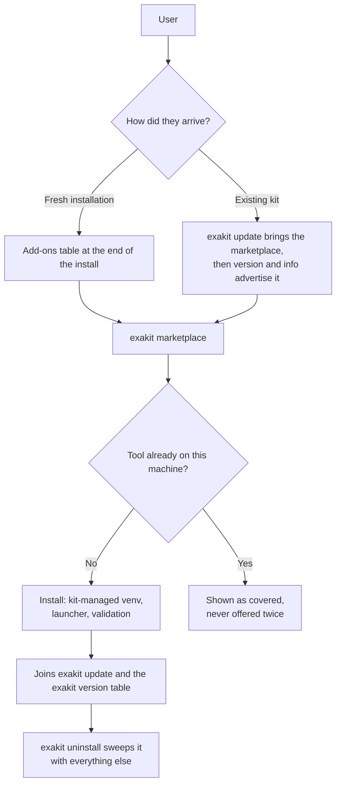
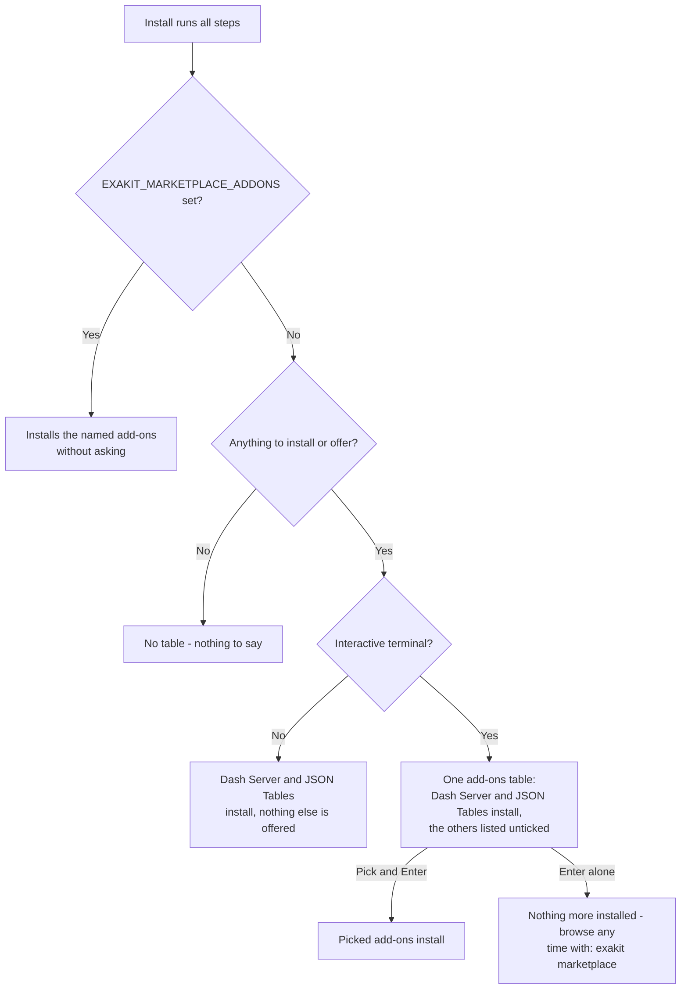
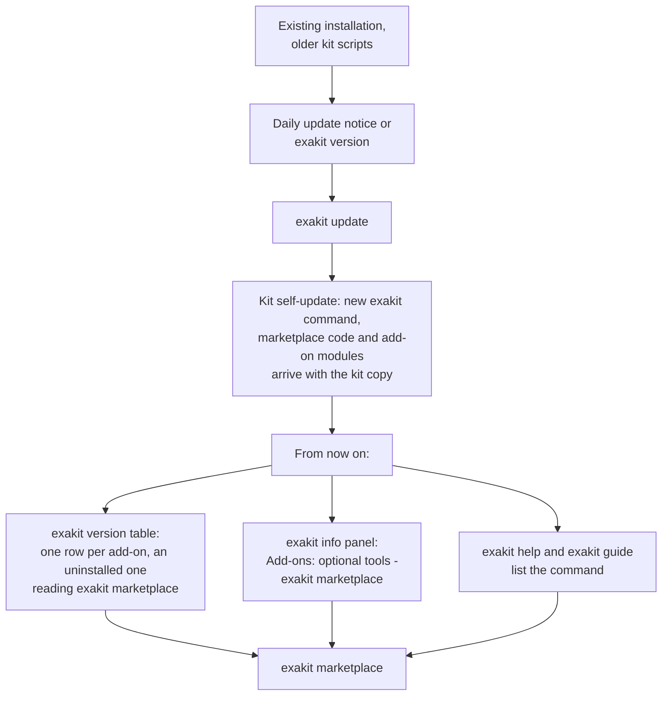
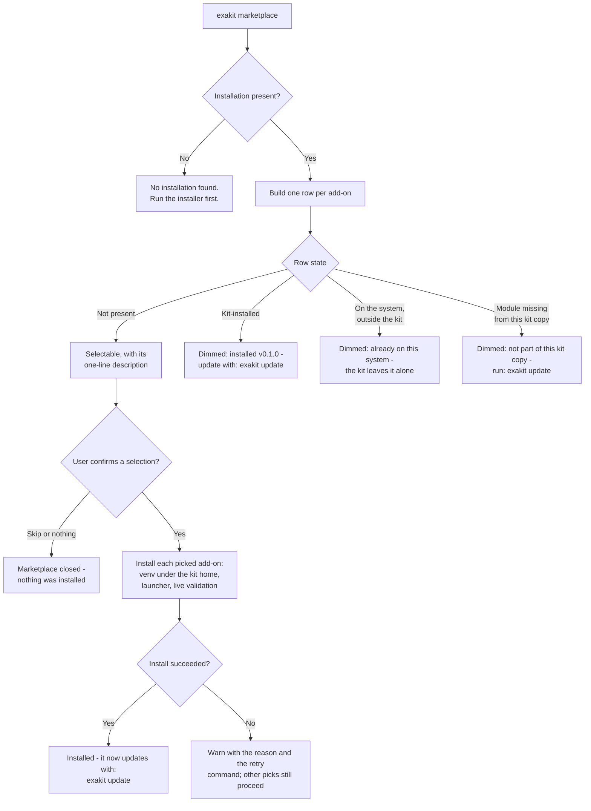
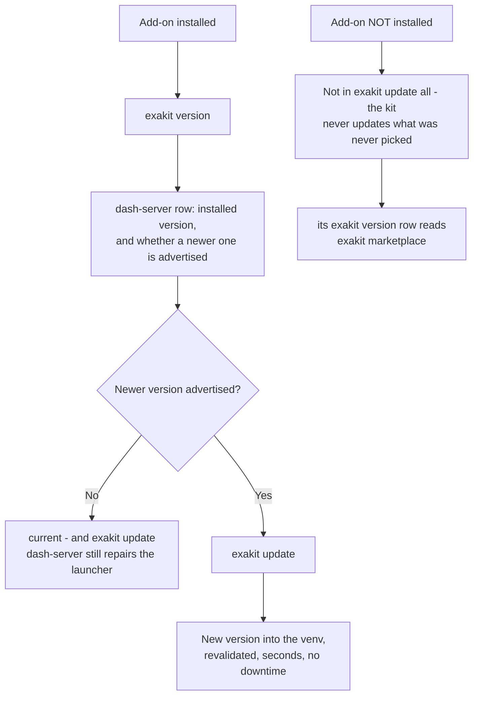
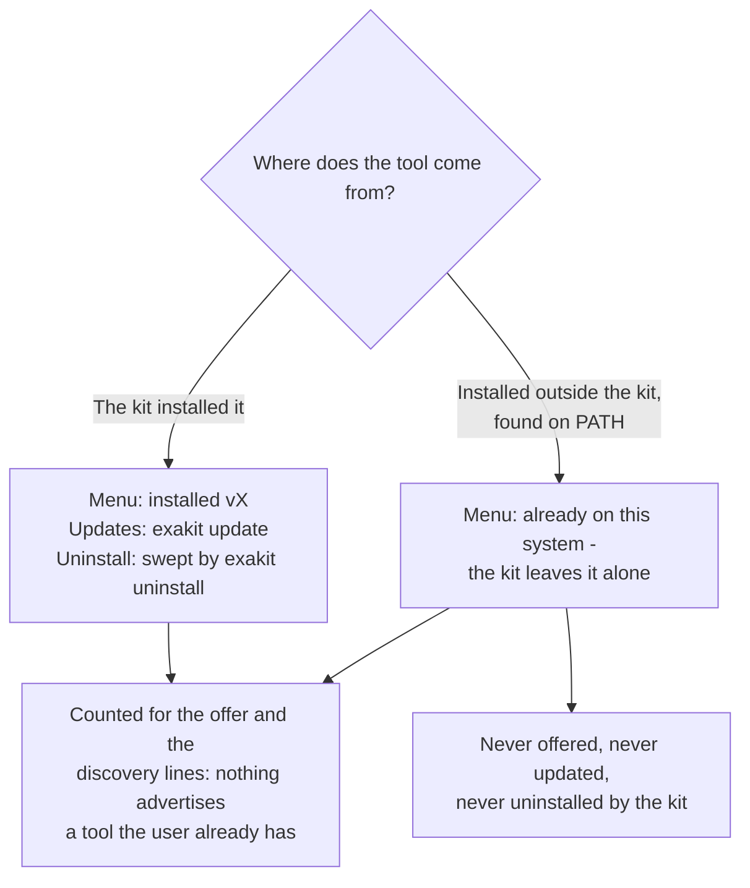
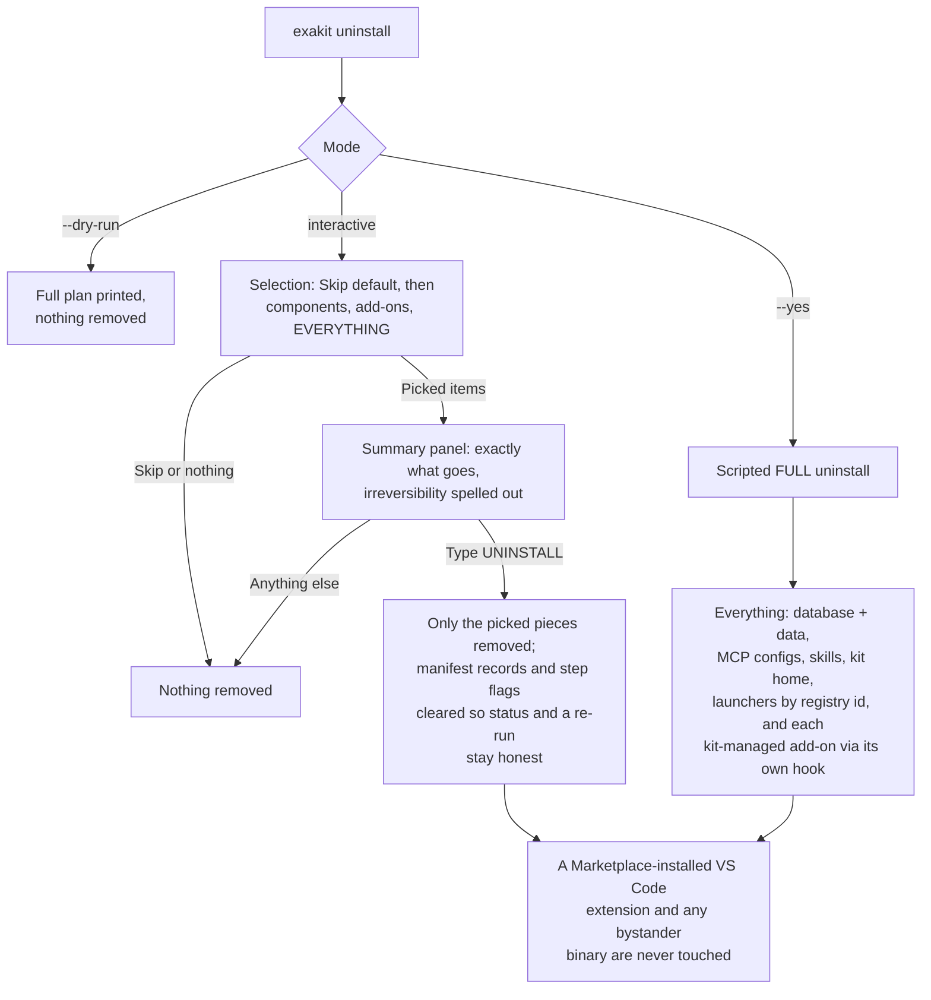

# The marketplace: optional add-ons, and how to add one

The marketplace is the kit's home for **optional tools** — things worth having
next to the database. Every install adds two of them by itself, Dash Server
and JSON Tables. The others come only when you pick them.

This document covers installation, updates, removal, and how to add a Python
marketplace component.

Contents:
[How it behaves](#how-it-behaves-the-contract) ·
[At a glance](#at-a-glance) ·
[1. Fresh installation](#scenario-1-fresh-installation) ·
[2. Existing kit, via the update path](#scenario-2-existing-kit-via-the-update-path) ·
[3. Browsing and installing](#scenario-3-browsing-and-installing) ·
[4. Keeping an add-on up to date](#scenario-4-keeping-an-add-on-up-to-date) ·
[5. The tool is already on the machine](#scenario-5-the-tool-is-already-on-the-machine) ·
[6. Removal](#scenario-6-removal) ·
[Where the marketplace appears](#where-the-marketplace-appears) ·
[Quick reference](#quick-reference) ·
[Where the pieces live](#where-the-pieces-live) ·
[Adding a new add-on](#adding-a-new-add-on-the-walkthrough) ·
[Verifying](#verifying)

---

## How it behaves (the contract)

- **Two add-ons come with every install.** Dash Server and JSON Tables
  (the auto-add list in `setup/lib/common.sh` and
  `setup/lib/exakit-common.ps1`) install with no question. On macOS and
  Linux they start early, in the background, while the data questions are on
  screen (`exakit_addons_early_begin`). On Windows they install from the
  add-ons table at the end. One of the two is skipped when it does not apply
  on this machine. `EXAKIT_MARKETPLACE_ADDONS=none` installs no add-on at all.
- **One add-ons table at the end, no question.** After the database and the
  core tools, the install draws one table under the heading *Supercharging
  Exasol with Add-ons*. The two add-ons above show their progress in it. The
  other add-ons are listed unticked: Space selects, Enter installs the picks,
  and Enter with nothing picked skips. There is no Yes/No gate before it.
- **`exakit marketplace`** is the command: every add-on with a one-line
  description, Space selects, Enter installs. Non-interactive runs (agents,
  CI) answer with `EXAKIT_MARKETPLACE_ADDONS=<ids csv | all | none>` instead.
  The same variable answers the install's add-ons table.
- **Dynamic by applicability.** An add-on that extends something the user does
  not have is not offered at all — no row, no table line, no mention anywhere.
  The VS Code extension is only listed on a machine that has VS Code; naming
  it anyway (`EXAKIT_MARKETPLACE_ADDONS=exasol-vscode`) explains that the host
  app is missing instead of failing deep in the installer. A copy the kit
  already installed stays visible even if the host app disappears later, so it
  can still be updated or removed.
- **Dynamic by presence.** An add-on already on the machine is never
  advertised — whether the kit installed it (shown as *installed (vX)*) or it
  was already on the system outside the kit (shown as *already on this system —
  the kit leaves it alone*; the kit never updates or uninstalls what it did
  not install). When everything is present, the offer and the discovery lines
  disappear entirely.
- **Installed add-ons are full components.** They join `exakit update`,
  report in `exakit version`, pin with
  `EXAKIT_<ID>_VERSION`, and are swept by `exakit uninstall`. Add-ons you never
  picked are never touched by `update all`.
- **Ownership receipts.** Each add-on the kit installs gets a receipt in the
  kit's manifest (`ownership: kit`). Updates and removals act only on what a
  receipt says the kit installed. Receipts from kit 0.2.5 and earlier are
  recognised as the kit's own (`marketplace/runtime.py`).
- **Semantic Views and JSON Tables are preprocessor modules.** The kit
  registers each one as a module of its SQL preprocessor framework after
  install and update (`marketplace/preprocessor_modules.py`). Semantic SQL and
  JSON paths then work in every session, with no per-session setup. The module
  is retired before the add-on is removed.
- **Every answer is read by one parser.** `EXAKIT_MARKETPLACE_ADDONS`,
  `exakit marketplace a,b` and the menu's preselection all go through
  `model.parse_ids`:
  case and spaces do not matter, a repeat counts once, `all` and `none` stand
  alone, and an empty part (`dash-server,`) or an unknown id is bad input -
  refused with exit 2, no `.last-failure` note, the known ids named - the same
  on bash and PowerShell.
- **A second run changes nothing.** `exakit marketplace <id>` for an add-on
  the kit already has says so and installs nothing; a skill or login entry
  already in place with the same bytes is neither rewritten nor reloaded (a
  reload would restart the service); `exakit update <id>` at the target
  version leaves a running service running; `uninstall <id>` of what is not
  installed says so and exits 0; `persona add` of a persona already recorded
  says *Already set up as* and leaves the manifest byte for byte; `persona
  remove` of one not recorded does the same. `EXAKIT_VERSION_POLICY=latest`
  asks GitHub or PyPI once per process.
- **No terminal, no question - and never a hang.** Without a terminal to read
  keys (CI, a pipe, a closed stdin) the menu prints how to answer with
  `EXAKIT_MARKETPLACE_ADDONS` and installs nothing. The install is the one
  exception: it still adds Dash Server and JSON Tables, and offers nothing
  else. A database restart that a
  step would need is refused, not taken, when nobody can confirm it (`--yes`
  confirms). `NO_COLOR`, `TERM=dumb`, `EXAKIT_NO_FANCY=1` or a non-UTF-8
  locale turn the drawn menu off (the message says which) and never colour a
  pipe; `TERM=dumb` gets the kit's own plain menus instead of the Textual one.

---

## At a glance

One add-on, from first contact to removal:



---

## Scenario 1: Fresh installation

The install has four steps: the Exasol launcher, the database, the setup
utilities (exapump, the SQL preprocessor framework and pyexasol) and the AI
bridge. The MCP server runs beside the database, and every AI client points
at its URL. Dash Server and JSON Tables install with no question (in the
background on macOS and Linux, from the table on Windows). The add-ons table
appears once, at the very end, and only when there is something to show.



On an interactive run the table looks like the one
[Scenario 3](#scenario-3-browsing-and-installing) shows. The rows of the two
add-ons the install adds turn *Auto installed* once each is in. The other
rows start unticked. There is no typing anywhere.

Details that matter:

- A run whose database did not install shows no add-ons table.
- A scripted or agent-driven install is never blocked by a question:
  `EXAKIT_MARKETPLACE_ADDONS=dash-server` (or `all` / `none`) answers it. With
  nothing set, the install adds Dash Server and JSON Tables and offers nothing
  else.
- Nothing in the offer can fail the install that just succeeded; it runs
  best-effort on every platform.

## Scenario 2: Existing kit, via the update path

A user who installed the kit before the marketplace existed reaches it
through the normal update mechanism. No reinstall.



Discovery is dynamic: `exakit version` gives a row only to an add-on this
machine could actually install, and an installed one reads as an ordinary
component instead. An updated kit whose user already has every tool never
mentions the marketplace at all.

The dim `Optional add-ons are available (dash-server) ...` footer under the
table is gone. It repeated, once per screen, the command the rows already
carry.

## Scenario 3: Browsing and installing

`exakit marketplace` is one screen in the kit's established look: a single
tree-checkbox table, the same component the data-load menu uses, carrying the
add-on, its version and its one-line description. Nothing starts ticked.
Space ticks the add-ons you want and Enter installs them. Enter with nothing
ticked answers `Skip`. With no terminal nothing is installed at all — the run says so and
names `exakit marketplace --list`, `exakit marketplace <id>` and
`EXAKIT_MARKETPLACE_ADDONS`.

```
  ╭─ Marketplace add-ons ────────────────────────────────────────────────────╮
  │     Add-on               Version  Description                            │
  │ [ ] Select All                                                           │
  │ [ ] ├─ dash-server       0.2.1    Agent-operated Dash hosting for live   │
  │     │                             analytical apps                        │
  │ [ ] ├─ dbt-exasol        1.12.3   Data Build Tool adapter for Exasol     │
  │ [ ] ├─ exasol-scheduler  0.4.1    Lightweight table-driven SQL job       │
  │     │                             scheduling for Exasol                  │
  │ [ ] ├─ exasol-vscode     1.9.1    A Visual Studio Code extension for     │
  │     │                             working with Exasol databases.         │
  │     │                             Provides comprehensive database        │
  │     │                             management, intelligent SQL editing,   │
  │     │                             and powerful query execution           │
  │     │                             capabilities.                          │
  │ [ ] ├─ json-tables       0.4.1    Exasol JSON Tables: ingest, query, and │
  │     │                             reshape JSON-shaped data in Exasol.    │
  │ [ ] └─ semantic-views    0.6.1    A database-native semantic layer for   │
  │                                   Exasol                                 │
  │ [ ] Skip                                                                 │
  ╰──────────────────────────────────────────────────────────────────────────╯
```

An add-on this machine cannot install — no VS Code-compatible editor, no
prebuilt binary for the architecture, already installed outside the kit — gets
a dimmed, unpickable row carrying the reason instead, or no row at all when it
is neither applicable nor present. Each row's name, link and description are
the add-on repository's own on GitHub (the id you type is shown beside a name
that differs, e.g. `exasol-json-tables (json-tables)`). They are looked up only
while installing and while showing updates (`exakit update`), and cached; every
other screen, and any lookup that fails, uses the copy in
`marketplace/catalog.json`, so the wording of a row can differ from the capture
above. At 80 columns a row shows the id (`json-tables`) where `name (id)` does
not fit its column; an add-on may carry child rows of its own under its row.
The same rows fill in with progress as each pick installs — the
selection and the install are one table, not two screens.



For dash-server specifically, "install" means: a Python venv at
`~/.exasol-starter-kit/dash-server-venv` (created with pip seeded, and
self-repaired if a pre-existing venv lacks pip), a launcher at
`~/.local/bin/dash-server` that bootstraps the kit's database connection at
run time (the password itself is never written into any file), and a live
check that the MCP control plane answers on `http://127.0.0.1:5100/mcp`
before the add-on is reported ready.

**That control plane is loopback-only and unauthenticated.** Anything that can
reach `127.0.0.1` on the machine can call its tools, which build, deploy and
pip-install dependencies for Dash apps as the installing user. Fine on a
personal laptop; on a shared or multi-user machine, stop dash-server when it is
not in use (`exakit stop`), and never expose the port on a LAN or through a
tunnel. Not every add-on is installed **against a kit-pinned checksum**:
dash-server is tag-pinned, but a GitHub source tarball publishes no digest to
verify the download against, and its Python dependencies come from PyPI
unpinned; dbt-exasol is pinned by version from PyPI, without hash checking.
exasol-scheduler, Exasol for VS Code, JSON Tables and Semantic Views are verified against
pinned digests and refuse an artifact whose digest they cannot check.

Non-interactive use, same contract as the install's add-ons table:

```bash
EXAKIT_MARKETPLACE_ADDONS=dash-server exakit marketplace   # ids csv, all, or none
```

## Scenario 4: Keeping an add-on up to date

Once installed, an add-on is a normal component. Nothing new to learn.



- `exakit update` (all) covers installed add-ons automatically and never
  touches uninstalled ones.
- `exakit version` lists the add-on with the live version from the venv.
- The advertised version comes from `versions.json` like every component;
  maintainers bump it with a one-file pull request and CI verifies the
  release tag exists before it lands.

## Scenario 5: The tool is already on the machine

The dynamic rule, in both directions:



Detection is honest in both directions: a stale manifest record without a
real install does not count as installed (the live probe is the authority),
and the kit's own launcher on PATH is not mistaken for a system install.

## Scenario 6: Removal

`exakit uninstall` is a selection too: Skip is the pre-selected safe default,
then the components actually on the machine, then the kit-managed add-ons —
each removable on its own — then EVERYTHING. What was picked is shown back in
a summary panel before the typed UNINSTALL gate.



One add-on goes with `exakit uninstall <add-on>`. Run it with `--dry-run`
first. The preview lists every step the real removal takes, from the code that
removes. That includes the database steps, such as users, roles and schemas.
For Semantic Views it names the schemas it drops with `DROP SCHEMA ... CASCADE`
and the `SEMANTIC_USER` role. For Semantic Views and JSON Tables, the
preprocessor module is retired first. The removal acts only on what the
add-on's ownership receipt says the kit installed.

```bash
exakit uninstall semantic-views --dry-run   # the full plan, nothing removed
exakit uninstall semantic-views             # asks first, --yes confirms
```

## Where the marketplace appears

| Surface | When | What it says |
|---|---|---|
| End of an interactive install | Something to install or offer | One add-ons table: Dash Server and JSON Tables install, the others listed unticked |
| End of an install with no terminal | Dash Server or JSON Tables missing | They install, nothing else is offered |
| `exakit version` table | Something still on offer | A row per add-on, an uninstalled one reading `exakit marketplace` in its Status cell |
| `exakit info` panel | Something still on offer | `Add-ons: optional tools (dashboards & more): exakit marketplace` |
| `exakit guide`, `exakit help`, `exakit catalog` | Always | The command with a one-line description |
| Anywhere above | Everything already present | Nothing - every mention disappears |

## Quick reference

| Situation | Command or event | Outcome |
|---|---|---|
| Fresh install, interactive | add-ons table at the end | Dash Server and JSON Tables install, the others listed unticked. Enter installs the picks, Enter alone skips |
| Fresh install, scripted | `EXAKIT_MARKETPLACE_ADDONS=...` | Installs the named add-ons, no questions (`none` installs no add-on) |
| Fresh install, no terminal, nothing set | add-ons step | Dash Server and JSON Tables install, nothing else |
| Kit from before the marketplace | `exakit update` | Kit self-update delivers the command; discovery lines take over |
| Browse | `exakit marketplace` | One row per add-on with live state; Space and Enter |
| Install failed | menu output | Reason plus retry command; nothing else breaks |
| Update one add-on | `exakit update` | Advertised version installed and revalidated |
| Update everything | `exakit update` | Installed add-ons included, others never touched |
| Tool already on the system | any surface | Respected and skipped; the kit does not manage it |
| Preview removing one add-on | `exakit uninstall <add-on> --dry-run` | Every step listed, the database ones included, nothing removed |
| Remove one add-on | `exakit uninstall <add-on>`, or pick it in `exakit uninstall` | Its own hook removes what its receipt records, after a confirmation |
| Remove the kit | `exakit uninstall` (EVERYTHING row, or `--yes`) | Full teardown, kit-managed add-ons included via their hooks; Marketplace-installed copies untouched |

Every behavior in the scenarios above is enforced by the automated suites
(`tests/marketplace.sh`, `tests/dry-run-matrix.sh`, `tests/uninstall.sh`) and
the sandboxed end-to-end run (`tests/marketplace-e2e.sh`).

---

The rest of this document is for whoever adds an add-on.

## Where the pieces live

| Concern | Source |
|---|---|
| Ordered add-ons and visibility | `marketplace/catalog.json` |
| Advertised versions and artifact checksums | Root `versions.json` |
| Offline UI runtime defaults | `marketplace/defaults.env` |
| Individual add-on lifecycle | `marketplace/addons/<id_with_underscores>.py` |
| Catalog validation and selection parsing | `marketplace/model.py` |
| Lifecycle dispatch and ownership checks | `marketplace/service.py`, `marketplace/runtime.py` |
| Interactive picker and batch progress | `marketplace/ui.py`, `marketplace/apply.py` |
| Bash/PowerShell entry adapters | `setup/exakit`, `setup/exakit.ps1`, `setup/lib/common.sh`, `setup/lib/exakit-common.ps1` |

The platform adapters launch Python and present CLI output. Add-on decisions,
installation, validation, and receipts live in `marketplace/`. The adapter
discovers supported hooks from the Python module through `metadata.py`; a new
add-on needs no shell or PowerShell lifecycle implementation.

## Adding a new add-on

1. Add an ordered row to `marketplace/catalog.json`: a unique `id`, a
   `github` block with the add-on's `repo` (`owner/name`), `backend: "python"`,
   `visible`, and `default_version`; then run `python3 tools/addon_github.py`,
   which writes the repository's `url`, `name` and `about` from GitHub. Never
   type those by hand, and never add a `label`: the row's name is the
   repository's. The one exception is an add-on the kit builds itself and that
   has no repository of its own: its `github` block names the
   upstream it is built on, so the row adds `kit_about`, one line (at most 120
   characters, at the end of the row) shown in place of that upstream's About.
   Set `visible: false`
   to stop new selections while keeping an existing installation manageable.
   Add `choices` only when the add-on has user-selectable variants.
2. Add `marketplace/addons/<id_with_underscores>.py`. Implement the lifecycle
   functions that the tool supports: `install`, `validate`, `update`,
   `uninstall`, `installed_version`, and optional service hooks such as
   `status`, `start`, `stop`, `url`, and `log_path`. Use
   `marketplace/runtime.py` for version selection, verified downloads,
   manifest receipts, and ownership. See `dash_server.py` for a service and
   `exasol_vscode.py` for a host application extension.
   Set `PARALLEL_INSTALL = True` in the module only when `install()` fetches
   and builds under the add-on's own folders, writes its receipt through
   `ctx.manifest`, reports through `ctx.activity` / `ctx.run_logged` /
   `ctx.log_event` (never `print`), and needs no other add-on installed first.
   `marketplace/apply.py` then runs it at the same time as the parallel-safe
   add-ons next to it in the selection. Its activity and log records are held
   back and replayed in selection order, and validate, skills, autostart and
   start still run one after the other, so the progress output and
   `marketplace.log` match a serial install. Leave the flag out for anything
   that drives a container, sets up UDFs in the database, or depends on
   another add-on. `EXAKIT_MARKETPLACE_PARALLEL=0` turns concurrency off for
   a whole run.
3. Add `setup/help/<id>.json` (`kind: "addon"`, with `role` and `docs`).
   `exakit help <id>` and `exakit marketplace --list --json` read it, and
   `tests/test_addon_help.py` fails without it.
4. Add the tested version and any published artifact digests to root
   `versions.json`. The catalog's `default_version` is an offline fallback;
   it is not the update pin. `exakit_component_latest_source` and the Python
   context apply the existing version policy and explicit override.
5. Add the id to the lists that name every add-on: `tests/marketplace.sh`,
   the `expected` components in `.github/workflows/versions.yml`, and a
   mention in AGENTS.md (`tests/agents-rosters.sh`).
6. Test an install, a repeat install, update, validation failure, user-owned
   discovery, and uninstall. Test the platform adapter only for behavior unique
   to the add-on. Do not put credentials in command arguments or catalog JSON.

The public commands remain `exakit marketplace <id>`,
`exakit marketplace --list`, `exakit version`, `exakit update <id>`, and
`exakit uninstall`. An unattended install can select IDs through
`EXAKIT_MARKETPLACE_ADDONS`. The catalog controls what is newly selectable;
ownership receipts control what the kit may update or remove.

## Verifying

```bash
python3 -m unittest discover -s tests -p 'test_marketplace_*.py'
bash tests/marketplace.sh
bash tests/dry-run-matrix.sh
bash tests/agent-operability.sh
bash tests/versions-manifest.sh
bash tests/ps-encoding-guard.sh
```

`tests/test_marketplace_rules.py` proves the rules above once each (the parser
on present, absent and malformed answers; the apply skip; skills and login
entries left alone; the persona record writer). `tests/test_marketplace_blackbox.py`
runs the real `exakit` as a subprocess on every entry point the host has (bash,
`pwsh`, `powershell`), with a timeout on every run: stdin from /dev/null, a pipe
and closed; `NO_COLOR`, `TERM=dumb`, `EXAKIT_NO_FANCY` and a forced palette
compared after stripping ANSI; `COLUMNS=60`; every environment answer present,
absent and malformed; and each command twice for idempotency, asserting that
bash and PowerShell give the same exit-code class, the same stream and the same
files. CI runs both on Linux, macOS and Windows PowerShell 5.1.

Run `tests/marketplace-e2e.sh` for the isolated integration path. A live
database and native Windows/WSL checks are separate.
